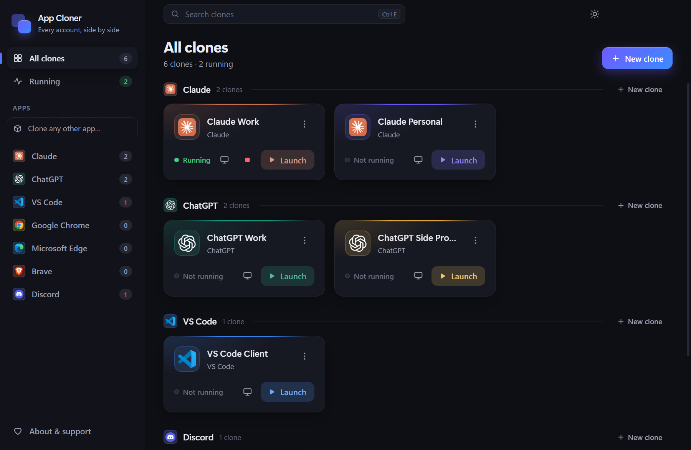
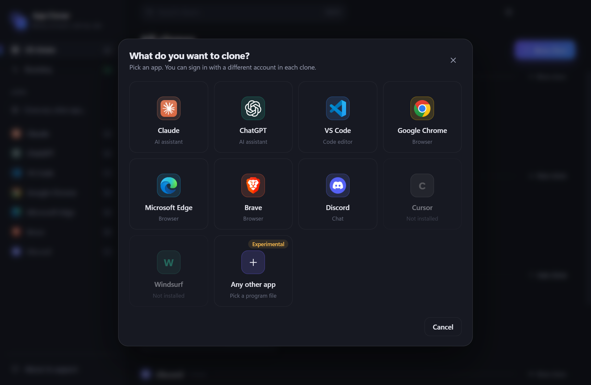
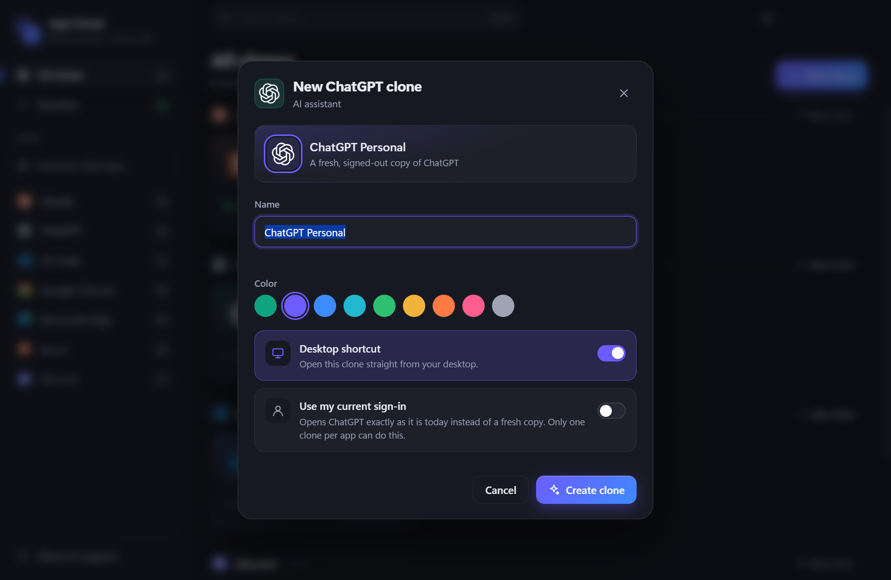
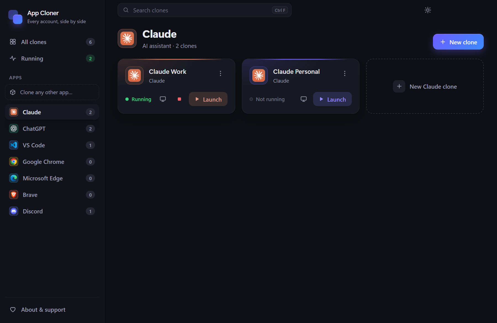
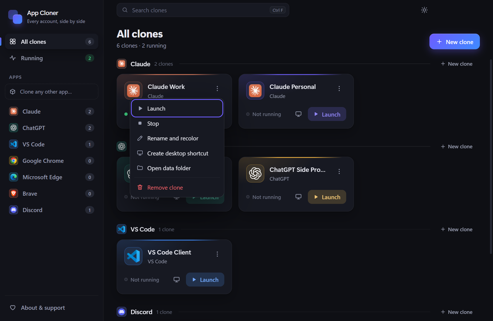
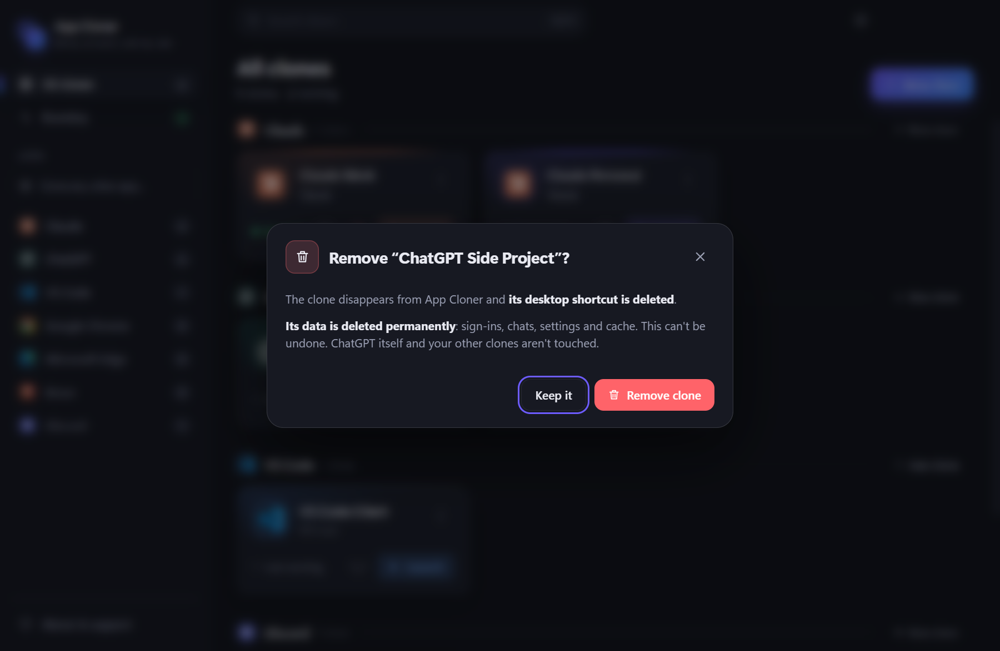
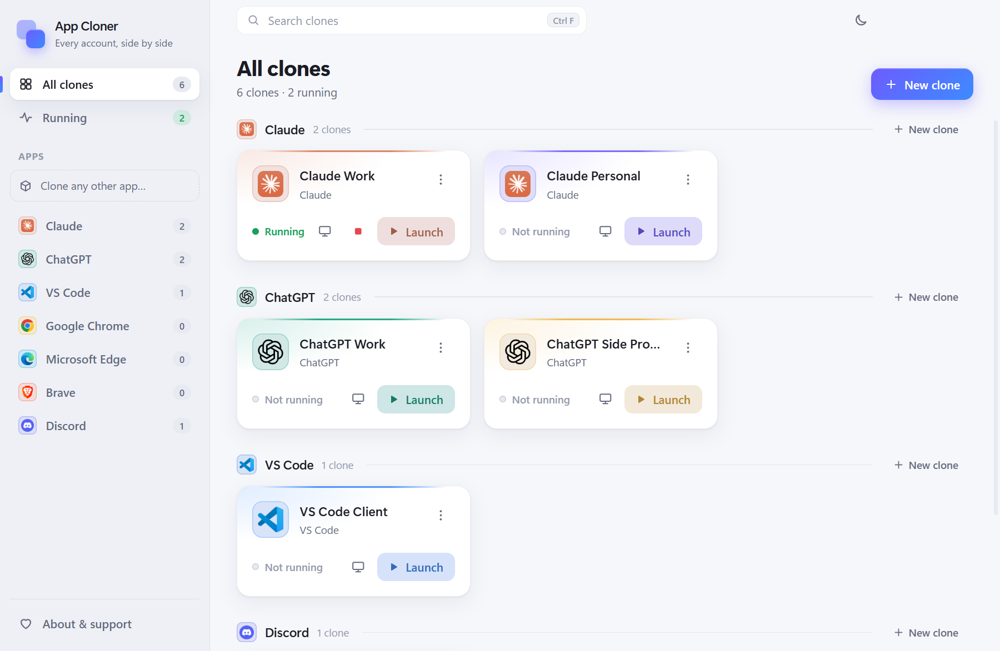
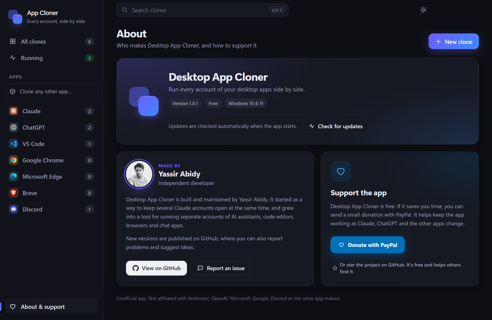

# Desktop App Cloner

**Run separate accounts of your desktop apps side by side on Windows.** Two Claude sign-ins, a work and a personal ChatGPT, a Discord for gaming, a VS Code per client: each clone has its own sign-in, its own name and color, and its own desktop shortcut.

**[⬇ Download the latest version](https://github.com/yassirabidy/desktop-app-cloner/releases/latest)** · Windows 10 & 11 · Free

## Download and install

1. Open the **[latest release](https://github.com/yassirabidy/desktop-app-cloner/releases/latest)**.
2. Under **Assets**, download **`DesktopAppCloner-<version>-Setup.exe`**.
3. Double-click it. It installs for your Windows user (no admin needed), adds Start menu and desktop shortcuts, and opens the app.

The other files in a release (`latest.yml` and the `.blockmap`) are used by the app to update itself; you don't need to download them.

**"Windows protected your PC"?** The app is not code-signed yet, so Windows SmartScreen may warn about it the first time. Click **More info › Run anyway**. Only do this for files downloaded from this page.

**Requirements:** Windows 10 or 11, and the apps you want to clone already installed.

## Supported apps

Claude · ChatGPT (with Codex) · Discord · VS Code · Cursor · Windsurf · Google Chrome · Microsoft Edge · Brave — plus **any other app** you add yourself (experimental).

## How it works

### 1. Pick an app

Click **New clone**. Apps installed on your PC are ready to clone; the others are greyed out. **Any other app** lets you pick a program file yourself.

### 2. Name it and choose a color

Give the clone a name, pick a color, and decide whether it gets its own desktop shortcut. The clone starts as a fresh, signed-out copy of the app — sign in there with your other account.

### 3. Launch, stop and manage your clones

Every clone has a card: **Launch** opens it, the green dot shows which ones are running, and the red **■** stops a running clone (also the ones hiding in the system tray). Click an app in the sidebar to see only its clones.

The **⋮** menu lets you rename and recolor a clone, create or refresh its desktop shortcut, open its data folder, or remove it.

### 4. Remove a clone when you no longer need it

Removing a clone deletes its shortcut and **its data** (sign-ins, chats, settings and cache), so your disk doesn't fill up over time. The original app and your other clones are never touched.

## Light or dark

Switch themes with the sun/moon button at the top right. Your choice is remembered.

## Updates

The app updates itself from this page. A new version downloads in the background while you work and installs when you close the app, or right away if you click **Restart**. Your clones, their sign-ins and their shortcuts are kept.

## About and support

Desktop App Cloner is free. If it saves you time, you can support it with a donation on **[PayPal](https://paypal.me/yassirabidy)**.

Found a problem or have an idea? **[Open an issue](https://github.com/yassirabidy/desktop-app-cloner/issues).**

---

**Discord tip:** a new Discord clone may sign itself in with the account that is open in your web browser. To use another account, open the clone, click your profile picture at the bottom left, choose **Switch Accounts › Add an Account**, then remove the first account from that clone.

This is an unofficial app, not affiliated with Anthropic, OpenAI, Microsoft, Google, Discord or other app makers.
